# 界面审查与重构记录（2026-10-11）

2026-10-12 整合更新：此文保留 PR #3 的原始审查记录。第三方 EQ／测量导入已在 [集成 PR #4](https://github.com/uselessbug/heytap-firmware-eq-studio/pull/4) 接入新版模块化界面，格式和 Preamp 安全语义见 [eq-formats.md](eq-formats.md)。同仓库 PR 的检查／打包依赖条件已修正；预览取消期间暂缓窗口销毁，待 QThread 完成再关闭。最新源码的验证与双打包结果以 PR #4 的 Actions 链接为准，原 PR #3 保持未合并。

分支 `feat/claude-ux`，基线 `feat/python-desktop-studio` 的 `e73704c`（与交接文档的 `e62d5d1` 只差一个文档提交）。本记录对应提交 `8366b70` 起的 `feat/claude-ux` 系列提交。

## 截图方法

全部截图来自真实 Qt 窗口（`MainWindow.grab()`，含内嵌 WebEngine 图形），不是单独的浏览器页面。开发机屏幕为 1280×800 逻辑像素（200% 缩放），窗口无法达到 1366/1920 宽，所以截图时设置 `QT_SCALE_FACTOR=0.5`，等同 100% 缩放的显示器。数据：

- 原始测量：`research/archives/enco_x4_eq_toolkit.zip` 里由 ReaLab HAR 提取的 `fr_0.csv`（丹拿原声）；
- 目标：合成曲线（低频搁架 + 3 kHz 耳增益 + 高频滚降），仅用于演示，不是公开目标；
- EQ：`research/enco_x4_eq_toolkit/examples/Technics-AZ80-Optimized.txt`；
- 固件：测试用合成 Enco X4 夹具（`tests/firmware_fixture.py` 同结构），不含厂商数据。

## 重构前的问题

| 问题 | 证据 |
| --- | --- |
| 图形只占窗口高度的约三分之一：1028×749 与 1366×768 下图形只有 258 px 高 | 窗口内 `studioInspect()` 读数；见 baseline 截图 |
| 顶部选择区被限制为可滚动的窄条，第二行在线选择和“测量参考”行被截断；展开“计算详情”会把原始／目标卡片完全挤出视野 | `baseline-firmware-details-1366x768.png` |
| 两排曲线复选框、标签页、图内标题、页脚提示、质量说明、状态栏共占约 300 px | 同上 |
| 禁用的“拟合到固件预设／导出固件”与可用按钮外观完全相同（工具栏文字亮度都是 230） | 像素采样 |
| 目标曲线（#e3ad55）与 RAW 节点（#efb55a）几乎同色；127 个 RAW 节点盖住曲线 | `baseline-tuning-1028x749.png` |
| 纵轴固定 ±24 dB，常见数据只占一半高度 | 同上 |
| 对话框按钮为英文 OK／Cancel；拟合对话框不能选基底；导出对话框不列出写入内容，也没有风险确认；生成修正对话框在 RAW 模式也显示 PEQ 数量 | baseline 对话框截图 |
| 固件表显示类型编号（4／1／2／3） | `baseline-tuning-table-1366x768.png` |
| 每次刷新向图形发送 317 KiB–1.2 MB JSON；带 DAC 时刷新耗时 38.7 ms，超过 25 ms 的拖动预览间隔 | 同一夹具测量 |
| 只有深色主题，颜色写死在 Python 与 CSS 两处 | `plot.py`、`editor.css` |

## 重构后

| 窗口 | 重构前图形 | 重构后图形 |
| --- | --- | --- |
| 1028×749 | 914×258 | 904×538（侧栏自动收起为步骤条；展开时 614×538） |
| 1366×768 | 1252×258 | 952×557 |
| 1920×1080 | 1806×547 | 1506×869 |

| 刷新负载（同一夹具，10 次中位数） | 重构前 | 重构后 |
| --- | --- | --- |
| 空窗口 | 317 KiB · 8.6 ms | 1 KiB · 0.3 ms |
| 测量 + 目标 + AZ80 EQ | 710 KiB · 19.8 ms | 176 KiB · 7.2 ms |
| + 固件参考 | 866 KiB · 27.9 ms | 212 KiB · 9.8 ms |
| + DAC1／DAC2 | 1201 KiB · 38.7 ms | 286 KiB · 13.2 ms |

主要变化：

- 左侧工作流侧栏（原始频响 → 目标 → 修正 EQ → 固件预设 → 导出），每步一行状态；在线选择在载入测量后自动收起；固件相关控件只在识别固件后出现，特殊配置单独排列。
- 窗口窄于 1200 px 时侧栏收成 40 px 的步骤条（①–⑤，完成的步骤高亮），点击某一步展开并滚动到对应卡片；只在跨过阈值时自动切换，手动选择会保持（Ctrl+B）。
- 生成修正改为 ③ 内的设置面板：修改模式、频段、强度、平滑、最大提升／衰减或对齐后，后台重新拟合并以“生成预览”虚线显示，应用前不改变修正 EQ；“应用到修正 EQ”是一步可撤销的操作。预览按输入签名（测量、目标、设置、固件估计上下文）校验，过期结果直接丢弃。
- 图例即曲线开关（另有“视图 → 曲线”），只列出当前可用曲线；模型假设移到图形标题栏的提示标签；切换测量或目标时自动适配 dB 范围；手势说明收进“?”。
- 外观：配色（跟随系统／浅色／深色）、对比度（跟随系统／标准／高对比度）和三种强调色，Qt 与图形共用一套颜色；Windows 切换配色或对比度主题时实时跟随。
- 参数表与固件信息改为停靠面板；状态栏只在有任务时显示进度和“取消”。
- 对话框中文化；拟合对话框同时选择基底与写入预设，默认写入另一个预设；导出前列出全部修改并要求确认“仅离线校验”。
- Python ↔ 图形消息升级为 schema 2，新增 `view`、`command` 事件，全部在 Python 侧校验。

| 重构前 | 重构后 |
| --- | --- |
| 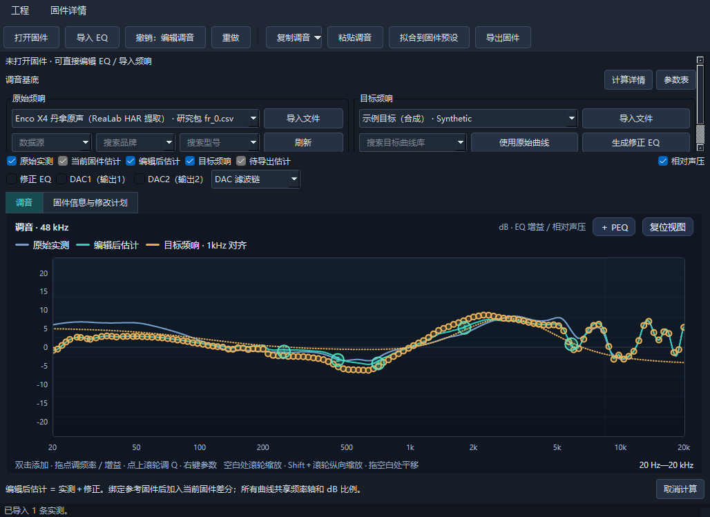 | 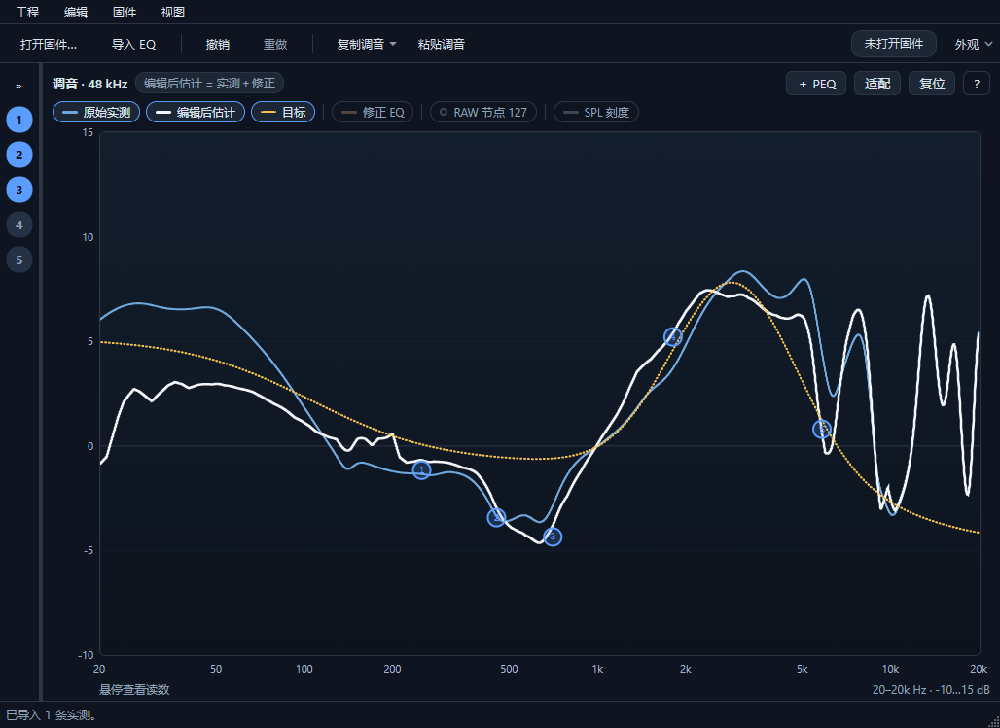 |
| 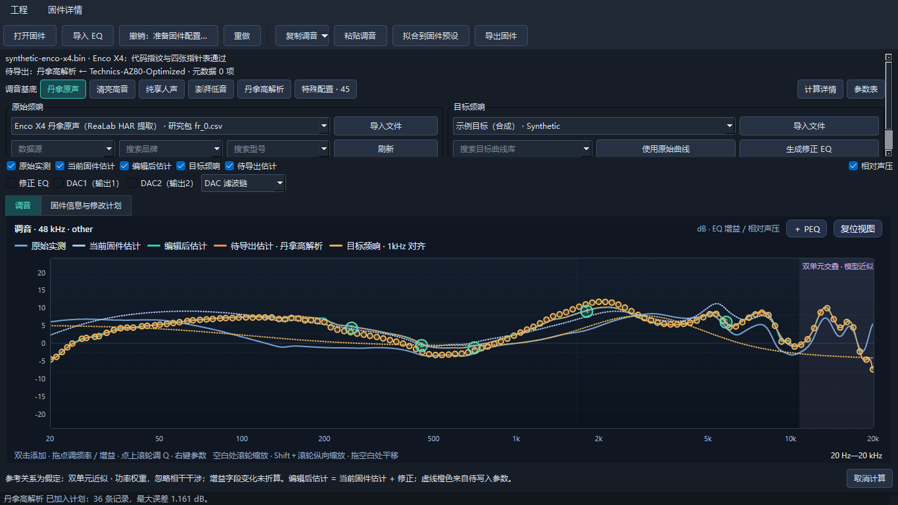 |  |
| 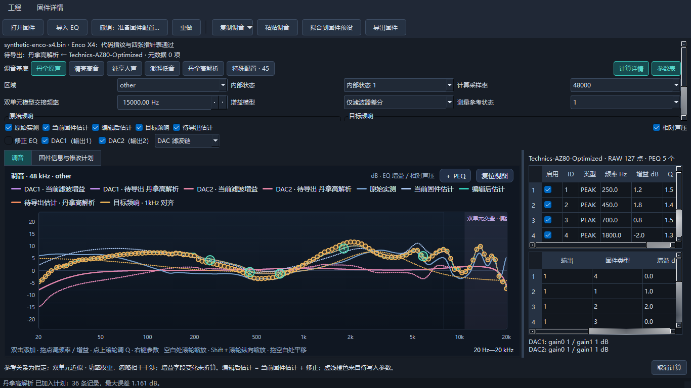 | 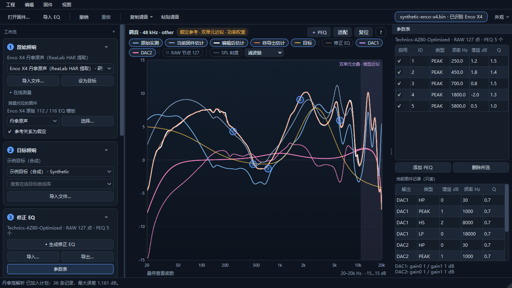 |
| 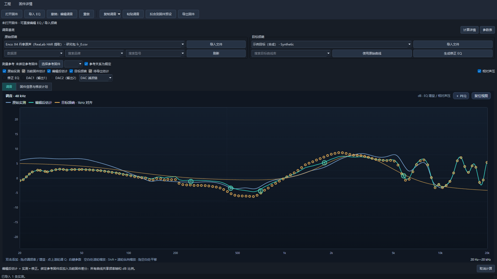 | 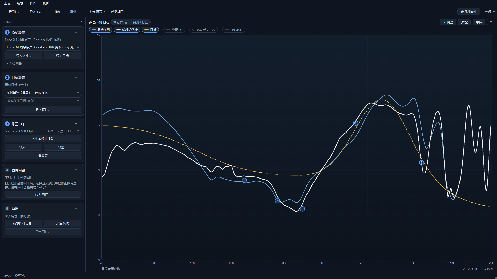 |
| 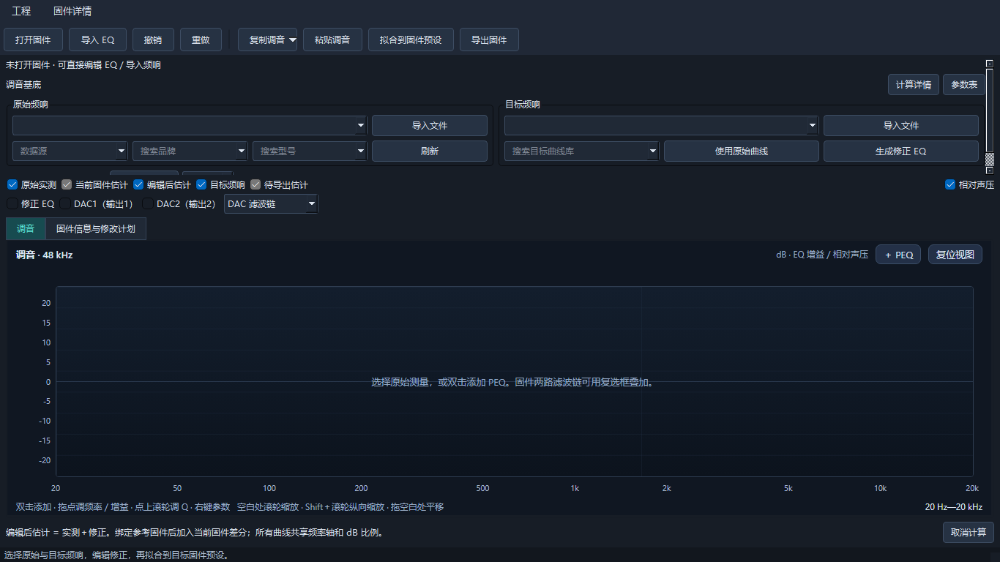 | 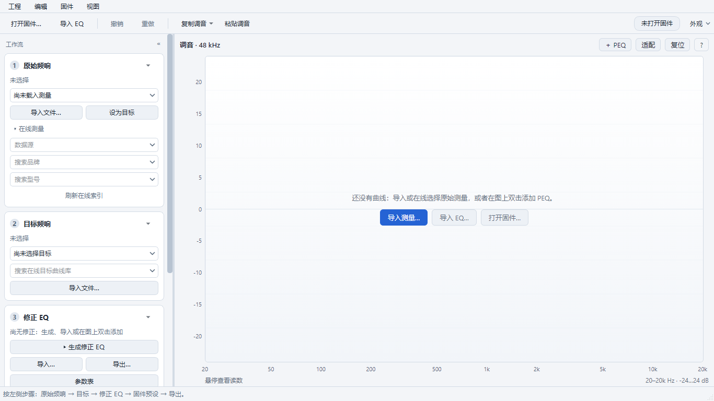 |
| 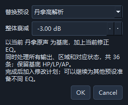 | 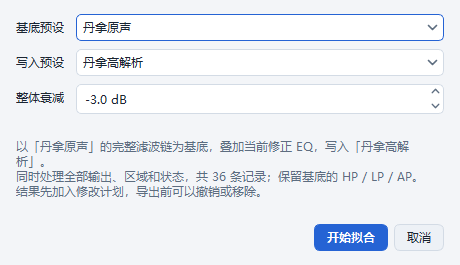 |
|  | 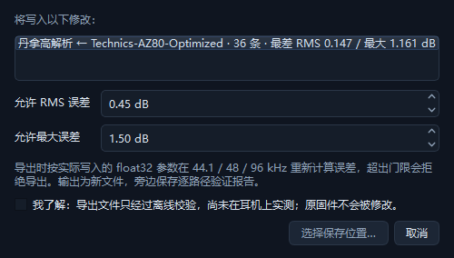 |
| 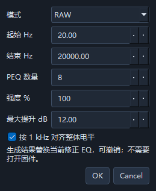 | 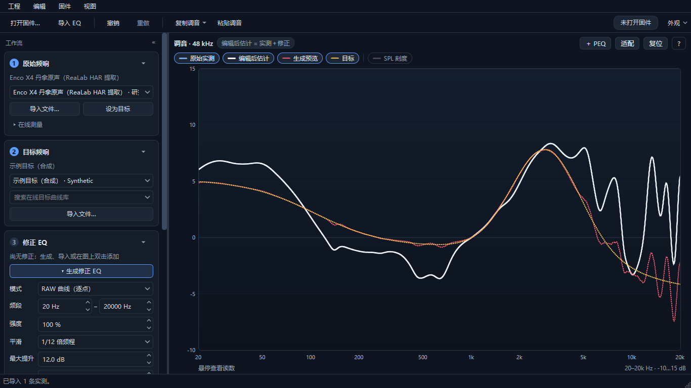 |
|  |  |

## 验证

- 本地 Windows 11，Python 3.11.9 + `requirements-ci.txt` 锁定依赖：`pytest` 93 项通过（原 53 项 + 主题、外壳、曲线组合、拟合回归），`ruff check .` 通过。
- 前端：`npm test` 4 项（含新增纵轴适配），`npm run test:browser` 保留全部原有交互，并新增主题变量、高对比度（曲线 1.5 倍、2 px 边框）、图例开关、适配、Delete 键、空状态命令。
- `python -m heytap_eq.app --smoke-test` 通过。
- fork Actions：push 只跑检查；手动运行包含 PyInstaller／Nuitka 打包、冻结 EXE 启动与两种 EXE 对比。`3d35610`（重构后的外壳）、`5a9df28`（侧栏折叠 + 内联生成修正）与 `3ff6536`（拟合提速、曲线组合、配色与高对比度、冻结检查）五个 job 全部通过。
- Windows runner 屏幕较小，窗口启动即低于 1200 px、侧栏为折叠状态；本地用 `QT_SCALE_FACTOR=1.1` 复现同一条件，外壳测试全部通过。

固件解析、DSP、固件拟合、写入与声学差分模型没有改动；测量 PEQ 拟合只改了目标函数的计算方式，结果不变（见“PEQ 拟合提速”）。工程 v4、撤销／重做、剪贴板格式保持兼容。

## 配色与高对比度

去掉了沿用自原界面的青绿色：默认强调色改为蓝色，删除“青绿”选项（旧设置自动改为蓝色）；“编辑后估计”改为中性粗线（深色白、浅色近黑），“生成预览”改为红色虚线，修正 EQ 改为棕褐色，强调色上的文字改为中性黑。测试会检查四套配色的所有颜色都不落在绿色／青绿色色相（75°–185°，饱和度 > 20%）。

| 配色 | 曲线与绘图背景最低对比度 | 曲线两两最小色差（CIE76 ΔE） |
| --- | --- | --- |
| 深色（原） | 6.4 | 36（“编辑后估计”“生成预览”为绿色） |
| 深色 | 5.7 | 26（当前固件估计／编辑后估计，另有虚实线区分） |
| 浅色 | 3.2 | 34 |
| 高对比深色 | 7.0 | 31 |
| 高对比浅色 | 4.8 | 29 |

高对比度是独立选项（外观 → 对比度：跟随系统／标准／高对比度），可与深浅色组合。跟随系统时读取 Windows“对比度主题”（Qt 6.8 不提供该信息，用 `SystemParametersInfo(SPI_GETHIGHCONTRAST)`；Qt 6.10 以上同时读取 `QStyleHints.accessibility()`），深浅色按对比度主题的窗口颜色判断；切换系统设置时通过 `ThemeChange` 事件实时更新，只在结果变化时重绘。高对比度不只换颜色：纯黑／纯白底，正文与次要文字 ≥ 7:1，边框、焦点框、网格 ≥ 3:1，禁用文字 ≥ 4.5:1 且与正文明显不同；控件边框与焦点框 2 px，菜单与列表选中项为实色，图形曲线加粗 1.5 倍、焦点轮廓 3 px。实际开关 Windows 对比度主题需要在本机系统设置中操作，自动测试用模拟的系统值和 `ThemeChange` 事件覆盖。

| 高对比深色 · 1366×768 | 高对比浅色 · 1366×768 | 高对比浅色 · 1028×749 |
| --- | --- | --- |
| 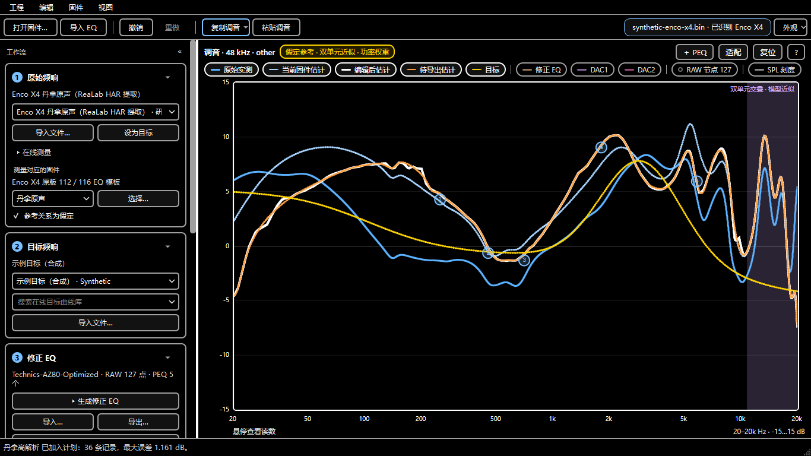 | 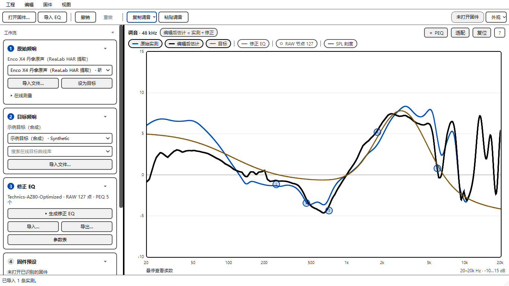 | 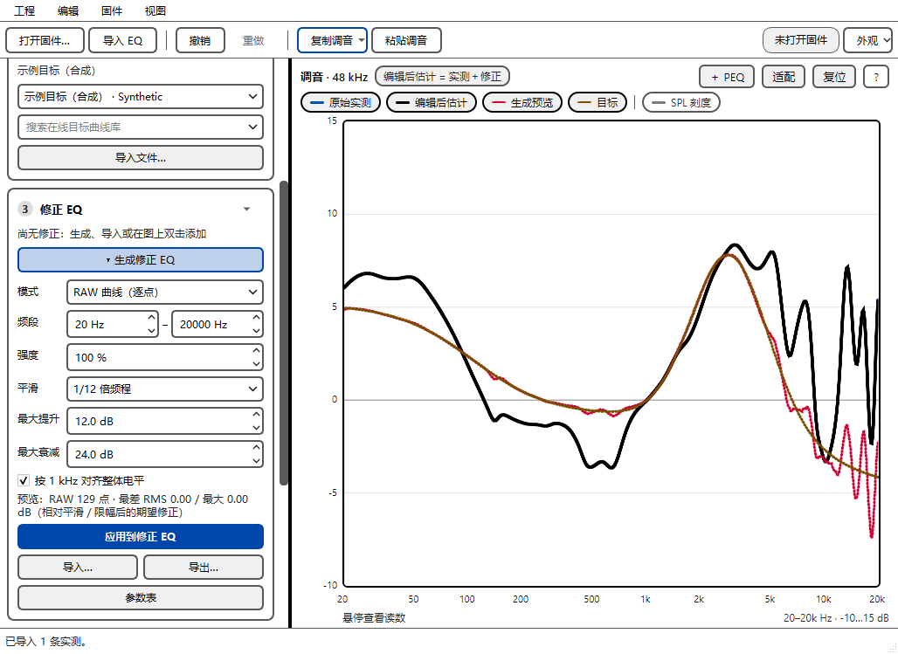 |

## 曲线组合

主窗口拆为 `gui.py`（核心）与 `gui_layout.py`、`gui_sources.py`、`gui_correction.py`、`gui_firmware.py`。图上显示哪些曲线、图例和模型提示由不依赖 Qt 的 `composition.compose(View)` 决定，`refresh()` 只收集控件状态并绘制结果。重构前后对 12 种窗口状态（空窗口、只有修正、测量＋目标、RAW＋PEQ、生成预览、固件差分与不确定频段、DAC 链／差分模式、待导出计划、隐藏曲线与相对刻度、RAW 节点关闭）比较了发往图形的完整数据，全部相同。`tests/test_composition.py` 在没有窗口的情况下检查 1 kHz 对齐、估计 = 实测 + 固件差分 + 修正、预览不改变修正、差分失败时的提示和 DAC 模式。

## PEQ 拟合提速

`fitting.fit_response` 的 PEQ 模式原来在每次目标函数调用里为每个滤波器、每个采样率分别构造并校验 `Filter`、调用一次 `firmware_dsp.coefficients`；8 个 PEQ 一次拟合约 9.4 万次调用，87% 的时间耗在这里。现在由 `peak_chain_response` 一次算出所有滤波器、三个采样率的 PEAK 级联，公式与 `firmware_dsp` 第 1 类相同，优化器与参数不变。另外 `least_squares` 每步的小矩阵 SVD 在 24 线程 OpenBLAS 下慢约 11 倍（6.6 ms 对 0.58 ms），程序启动时默认单线程（作者的 CI 基准本来就这样设置），用户自行设置的环境变量优先。

| 本机 · 5 组输入（3 组为 ReaLab 测量，未入库） | 原来 | 现在 |
| --- | --- | --- |
| 2 个 PEQ | 0.06–0.13 s | 0.01–0.02 s |
| 4 个 PEQ | 0.47–1.6 s | 0.03–0.13 s |
| 8 个 PEQ | 5.5–11.5 s | 0.26–0.64 s |
| 12 个 PEQ | — | 1.0–1.4 s |
| 20 个 PEQ | 约 1–2 分钟（估计） | 2.9–4.3 s |

结果对照：2／4／8 个 PEQ 的 15 组拟合与原实现逐位相同（滤波器参数与各采样率误差）；300 组随机滤波器链的响应逐位相同。单线程 BLAS 只改变 20 个 PEQ 中 4 组的舍入路径，RMS 有升有降（例如 0.110→0.074、0.037→0.049 dB），这类长链拟合本来就随机器核数变化。也试过解析雅可比：20 个 PEQ 快 4–5 倍，但部分输入的最大误差从 0.22 dB 变成 2.2 dB，没有采用。

回归测试：`test_vectorised_peak_chain_matches_the_firmware_biquads`、`test_peq_fit_is_unchanged_from_the_per_filter_objective`（用原目标函数重新拟合并比较）、`test_eight_peq_fit_stays_interactive`；`--benchmark` 新增 8 个 PEQ 的工作量，两种 EXE 的结果在 CI 中互相比对。固件预设拟合（`firmware_edit.fit_record`，每条约 3 s）属于写入链路，没有改动。

## 打包（Nuitka／PyInstaller）

结论：Nuitka 打包实现正确。依据 `3ff6536` 的 Actions 产物：

- 构建：`--mode=standalone --enable-plugin=pyside6 --msvc=latest`，32 个 `heytap_eq` 模块全部编译为 C（含新增的 `composition`），`--include-package-data` 带上了 `web/` 与 `data/`；编译报告 0 条警告。报告中可以看到 `QtWebEngineProcess.exe`、`icudtl.dat`、WebEngine 资源、`qsvg.dll`／`qsvgicon.dll` 及其依赖 `qt6svg.dll`、`qtbase_zh_CN.qm`。未编译的 Python 模块主要是 CPython 启动所需的标准库，属于 Nuitka 的正常行为。
- 运行：冻结 EXE 实际启动，窗口可见，WebEngine 图形绘制 3 条曲线；新增检查要求主题的 SVG 箭头能加载、zh_CN 翻译已安装、未设置环境变量时 BLAS 为单线程，Nuitka 与 PyInstaller 两种 EXE 都通过（检查脚本会先从子进程环境中移除该变量）。
- 一致性：同一 runner 上交替运行三次，两种 EXE 的全部数值输出（EQ 文本往返、频响、2／8 个 PEQ 拟合、固件 RAW 拟合）在 1e-5 内相同。
- 性能：Nuitka 比 PyInstaller 快 1.01–1.15 倍（启动 1.62 对 1.80 s；8 个 PEQ 拟合 0.39 对 0.40 s）。计算主要在 numpy／scipy／Qt 的原生代码里，编译 Python 收益有限，这是预期结果；构建 305 s（有缓存），PyInstaller 约 45 s。
- 体积：Nuitka 455 MiB／534 个文件，PyInstaller 约 520 MiB／2933 个文件，主要来自 QtWebEngine。

## 尚未完成

按影响排列：

1. 固件预设拟合慢，且超限只在导出时才知道。用内置的真实 Enco X4 参考预设测量：每个预设 36 条记录里有 6–7 组不同的基底滤波器，一次“拟合到固件预设”约 16 s（每组 1.4–3.1 s，`firmware_edit.fit_record`）。修正幅度较大时，7 组中有 5 组 RMS 为 0.45–0.71 dB，超过导出默认限值 0.45 dB；计划阶段只显示最大误差，导出时才报错。建议：计划列表与导出对话框按限值标出通过／超限；`fit_record` 可以用与 PEQ 相同的向量化目标函数提速，但属于固件写入链路，需要逐位对照的回归测试并单独提交。
2. 原有 `tests/test_gui.py` 仍用 `QTest.qWait` 等待后台任务；PySide6 6.8 在 `qWait` 期间持有 GIL，后台 Python 线程会慢约 200 倍（0.3 s 的拟合超过 60 s）。改为事件循环等待即可，测试更快、更不容易超时。
3. AutoEQ／Equalizer APO／REW 导入在原 PR #3 中尚未并入；已在集成 PR #4 完成，与原测量、目标、EQ 文件及剪贴板入口共用严格解析器。
4. 撤销快照每次都复制并逐点校验全部测量和目标（最多 100 步），曲线多时每次编辑的开销随总点数增长；可以改为共享不可变曲线，只记录选择变化。
5. 图上的 PEQ 节点不能用键盘选择或微调，只能用“参数表”面板；高对比度用户更需要这条路径（例如 Tab 切换节点、方向键调频率／增益）。
6. 两种 EXE 都没有程序图标、版本信息资源和代码签名，Windows 会显示 SmartScreen 警告；Nuitka 可加 `--windows-icon-from-ico`、`--product-name`、`--file-version`，PyInstaller 用 `--icon`、`--version-file`。另外 Nuitka 版使用 `--windows-console-mode=attach`，从终端启动时会把输出写到该终端，PyInstaller 版（`--windowed`）不会，两者行为略有不同。
7. Windows 对比度主题的实时切换只能用模拟的 `ThemeChange` 测试；需要在实际机器上开关一次系统设置确认。
8. Flowmix 使用内置授权并以 App 的 User-Agent 访问，按 CLAUDE.md 需要与维护者讨论，本轮没有改动。
9. `docs/handoff.md` 等历史文档有部分内容已过时（CLAUDE.md 也已说明）。
10. 截图来自源码运行；冻结 EXE 由 Actions 的启动检查与截图验证。
